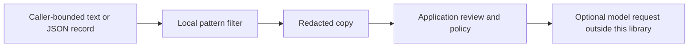

# AI Context Redactor

[](https://github.com/luminosstudioai-creator/ai-context-redactor/actions/workflows/ci.yml)

**Reduce selected sensitive patterns before constructing an AI request.**
A small offline Python utility for deterministic text redaction and structured
record masking. No network calls, model dependencies or original-value export.



## Try it in 30 seconds

```sh
git clone https://github.com/luminosstudioai-creator/ai-context-redactor.git
cd ai-context-redactor
python3 demo.py
```

Actual synthetic demo output:

```text
Contact [EMAIL_1]; account [IBAN_1]; token=[SECRET_1]
{
  "email": "[REDACTED]",
  "note": "Invoice EUR 42.50",
  "API-Key": "[REDACTED]"
}
```

```python
from redactor import redact, redact_record

redact('alice@example.com cc alice@example.com')
# '[EMAIL_1] cc [EMAIL_1]'
redact_record({'password': 'synthetic', 'amount': 42.5})
# {'password': '[REDACTED]', 'amount': 42.5}
```

For a UTF-8 stream: `python3 redactor.py < input.txt > filtered.txt`.
After installation the command is also `ai-context-redactor`. Exit `0` on
success, `2` on invalid/excessive input; errors do not echo input values.

## Supported rules

| Input | Rule |
|---|---|
| Text | ASCII-style email patterns |
| Text | Uppercase German IBANs with mod-97-valid checksum, optional single spaces between digits |
| Text | Simple api_key / access_token / token / password / secret assignments, including identifier prefixes such as OPENAI_API_KEY and AWS_SECRET_ACCESS_KEY |
| JSON record | Entire values under email, iban, api_key, access_token, token, password, secret, authorization |

Record key matching is case-insensitive and ignores underscores/hyphens.
Other string values and keys pass through the text rules. Key collisions raise
`RedactionError` rather than dropping data. Input objects are not modified.
Secret assignment spans take priority over overlapping email/IBAN spans.
Repeated equal text values share a marker **within one string**; numbering
resets between strings. Markers are not global IDs or reversible references.

Text and CLI input default to 65,536 UTF-8 bytes. Records allow depth 20,
10,000 nodes and 65,536 aggregate string bytes, including masked values.
Cycles, non-finite floats and non-JSON types fail.

## Limits and threat boundary

**This is not anonymization, complete DLP or a prompt injection defense.**
Names, addresses, phone numbers, non-German IBANs, obfuscated credentials,
unusual email syntax and escaped/multiline credential formats may remain.
Pattern matching can also remove harmless data. Inspect the result and apply
your organization's data policy before any external request. Never treat a
successful call as evidence that sharing is permitted.

Input and temporary matching data exist in process memory; there is no secure
erasure. The tool cannot undo earlier logging or exposure. Marker-like text
can already occur in input, so markers must not be used for authorization or
trusted downstream decisions. Output may still contain personal data. The
library does not parse JSON text automatically; pass structured objects to
`redact_record` for key-based masking.

## Verification

```sh
python3 -m unittest discover -s tests -v
python3 -m pip install --no-deps .
```

CI runs tests, installs the package and imports it outside the checkout on
Python 3.11, 3.12 and 3.13. No runtime dependencies, API credentials or paid model
calls are required. Build tooling is separate from the runtime.

## Provenance

A new, standalone implementation by Mika Mischke. Examples are synthetic.
This repository does not contain private application code, client datasets,
customer references or a claim of production deployment. MIT licensed.
